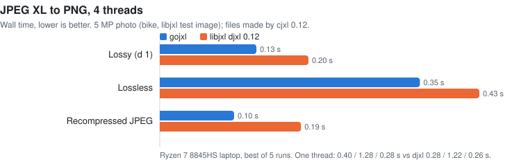
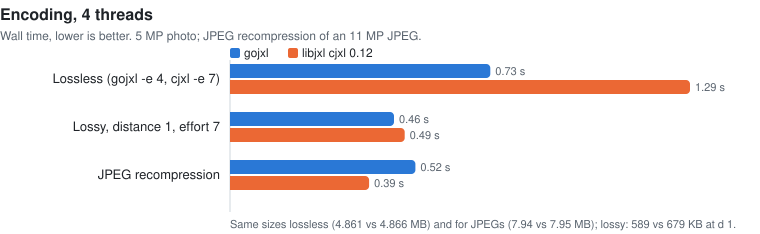
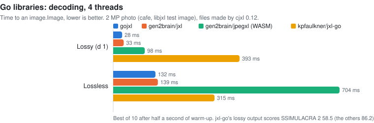
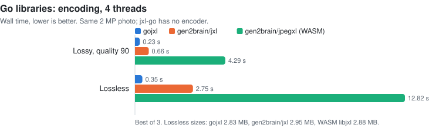

<p align="center">
  
</p>

<h1 align="center">gojxl</h1>

<p align="center">
  <b>JPEG XL for Go: encoder, decoder and converter, in pure Go.</b><br>
  No cgo, no assembly, no WASM runtime. One static binary for every platform Go builds for.
</p>

<p align="center">
  <a href="https://pkg.go.dev/github.com/bdrtr/gojxl"></a>
  <a href="https://github.com/bdrtr/gojxl/releases"></a>
  <a href="LICENSE"></a>
  
</p>

<p align="center"><a href="README.tr.md">Türkçe</a> · <a href="#install">Install</a> · <a href="#how-it-compares">Comparison</a> · <a href="#benchmarks">Benchmarks</a> · <a href="#correctness">Correctness</a></p>

---

## Highlights

- **Smaller files than libjxl** at the same quality. Against `cjxl -e 7`, at equal
  [SSIMULACRA 2](https://github.com/cloudinary/ssimulacra2) scores (BD-rate):
  **−8.2 %** on 15 photos (−11 % at high quality) and **−10.2 %** on 15
  diagrams, icons and screenshots. Lossless and JPEG-recompressed files are
  0.5 % smaller over a 1,983-file real-world corpus.
- **The fastest Go JPEG XL library on 4 threads**: it decodes 2–15 % faster
  than gen2brain/jxl and 3–5× faster than libjxl compiled to WASM, encodes 2–8×
  faster than gen2brain/jxl and 14–37× faster than the WASM build, and converts
  JPEG XL to PNG faster than libjxl's own `djxl` (see [benchmarks](#benchmarks)).
- **Lossless JPEG recompression**: about 20 % smaller files, and the original
  JPEG comes back **byte for byte** (also from files made by `cjxl`; djxl
  reconstructs ours).
- **Every common format in and out**: PNG/APNG, GIF, JPEG, WebP (own decoder,
  bit-exact with libwebp), TIFF, BMP and PGM/PPM/PAM in; PNG/APNG, JPEG, PNM
  and PFM out. Animation, alpha, 16-bit, HDR (PQ/HLG) and ICC colour management
  included.
- **Checked against the reference**: the libjxl conformance suite decodes within
  112–216 dB of `djxl`, and every encoder output is decoded by `djxl` too.

## Install

Command line tool, from source (Go 1.24 or newer):

```sh
go install github.com/bdrtr/gojxl/cmd/gojxl@latest
```

or download a binary (Linux, macOS, Windows; amd64 and arm64) from the
[releases](https://github.com/bdrtr/gojxl/releases) page.

Library:

```sh
go get github.com/bdrtr/gojxl
```

## Usage

```sh
gojxl encode photo.png photo.jxl            # lossless (keeps the colour profile and Exif/XMP)
gojxl encode -q 90 photo.png photo.jxl      # lossy, cjxl-style quality (90 = distance 1)
gojxl encode photo.jpg photo.jxl            # lossless JPEG recompression
gojxl encode anim.gif anim.jxl              # GIF / APNG / WebP animation -> JXL animation
gojxl decode photo.jxl photo.png            # animations become APNG
gojxl decode photo.jxl photo.jpg            # the original JPEG, byte for byte
gojxl encode -q 85 -o out/ photos/          # whole directory trees, in parallel
gojxl compare photo.png photo.jxl           # SSIMULACRA 2 and PSNR
gojxl info photo.jxl
```

```go
import "github.com/bdrtr/gojxl"

img, err := gojxl.Decode(r)                                      // also registered with image.Decode
err = gojxl.Encode(w, img, &gojxl.EncodeOptions{Distance: 1})    // lossy; Distance 0 = lossless
jxl, err := gojxl.ConvertToJXL(fileBytes, nil)                   // PNG/GIF/JPEG/WebP/TIFF/BMP/PNM -> JXL
err = gojxl.ConvertToPNG(w, jxl, nil)                            // streamed straight to PNG
jpg, err := gojxl.ReconstructJPEG(jxl)                           // the original JPEG
score, err := gojxl.SSIMULACRA2(original, distorted)
```

## How it compares

| | **gojxl** | [gen2brain/jxl] | [gen2brain/jpegxl] | [kpfaulkner/jxl-go] | [libjxl] |
|---|---|---|---|---|---|
| Written in | **pure Go** | Go + SIMD assembly | libjxl as WASM, run by wazero | pure Go | C++ |
| Decode | ✅ | ✅ | ✅ | partial (work in progress) | ✅ |
| Encode, lossy and lossless | ✅ | ✅ | ✅ | — | ✅ |
| Alpha when encoding | ✅ | ✅ | ✅ | — | ✅ |
| Animation | encode + decode | decode | decode | — | encode + decode |
| Lossless JPEG recompression and byte-exact reconstruction | ✅ | — | — (pixels only) | — | ✅ |
| ICC colour management on output | ✅ | — | | — | ✅ |
| File formats in | PNG, APNG, GIF, JPEG, WebP, TIFF, BMP, PNM | `image.Image` | `image.Image` | — | PNG, APNG, GIF, JPEG, EXR, PNM |
| Command line tool | ✅ | — | — | — | ✅ |
| Lossy size vs `cjxl -e 7` at equal SSIMULACRA 2 | **−8 % photos, −10 % graphics** | +2 … +15 % (its README) | ≈ 0 (it is libjxl) | — | reference |

Rows for the other libraries come from their documentation (November 2026:
gen2brain/jxl v0.2.1, gen2brain/jpegxl v0.6.0); empty cells are not
documented. [bench/rivals](bench/rivals) times all four Go
libraries on the same files.

[gen2brain/jxl]: https://github.com/gen2brain/jxl
[gen2brain/jpegxl]: https://github.com/gen2brain/jpegxl
[kpfaulkner/jxl-go]: https://github.com/kpfaulkner/jxl-go
[libjxl]: https://github.com/libjxl/libjxl

## Benchmarks

<picture>
  <source media="(prefers-color-scheme: dark)" srcset="docs/decode-dark.svg">
  
</picture>

<picture>
  <source media="(prefers-color-scheme: dark)" srcset="docs/encode-dark.svg">
  
</picture>

| 5 MP photo, wall time | gojxl, 1 thread | libjxl, 1 thread | gojxl, 4 threads | libjxl, 4 threads |
|---|---|---|---|---|
| Decode lossy file to PNG | 0.40 s | **0.28 s** | **0.13 s** | 0.20 s |
| Decode lossless file to PNG | 1.28 s | **1.22 s** | **0.35 s** | 0.43 s |
| Decode recompressed JPEG to PNG | 0.28 s | **0.26 s** | **0.10 s** | 0.19 s |
| Encode lossless (gojxl `-e 4`, cjxl `-e 7`, same size) | **2.47 s** | 4.66 s | **0.73 s** | 1.29 s |
| Encode lossy, distance 1, effort 7 | 1.48 s | **1.26 s** | **0.46 s** | 0.49 s |
| Recompress an 11 MP JPEG (same size) | 1.30 s | **0.75 s** | 0.52 s | **0.39 s** |

libjxl (`cjxl`/`djxl` 0.12) uses AVX2 SIMD; gojxl is plain Go and gets ahead by
doing more in parallel, the PNG writer included. At distance 1 the lossy files
are 589 KB (SSIMULACRA 2 84.4) against 679 KB (84.0). Peak memory is somewhat
higher than libjxl's when decoding (about 100 MB vs 62 MB here) and lower when
encoding. Ryzen 7 8845HS laptop, best of 5 runs.

### Against the other Go libraries

<picture>
  <source media="(prefers-color-scheme: dark)" srcset="docs/rivals-decode-dark.svg">
  
</picture>

<picture>
  <source media="(prefers-color-scheme: dark)" srcset="docs/rivals-encode-dark.svg">
  
</picture>

| 2 MP photo (cafe) | gojxl | gen2brain/jxl | gen2brain/jpegxl (WASM) | kpfaulkner/jxl-go |
|---|---|---|---|---|
| Decode lossy, 1 thread | 74 ms | **67 ms** | 97 ms | 561 ms (wrong output) |
| Decode lossy, 4 threads | **28 ms** | 33 ms | 98 ms | 393 ms (wrong output) |
| Decode lossless, 1 thread | **480 ms** | 506 ms | 710 ms | 1,104 ms |
| Decode lossless, 4 threads | **132 ms** | 139 ms | 704 ms | 315 ms |
| Encode lossy, quality 90, 1 thread | **0.75 s** | 1.69 s | 4.37 s | — |
| Encode lossy, quality 90, 4 threads | **0.23 s** | 0.66 s | 4.29 s | — |
| Encode lossless, 1 thread | **1.18 s** | 3.53 s | 12.11 s | — |
| Encode lossless, 4 threads | **0.35 s** | 2.75 s | 12.82 s | — |
| Lossless file size | **2.83 MB** | 2.95 MB | 2.88 MB | — |

gojxl is the fastest of the four on 4 threads and encodes 2–8× faster than
gen2brain/jxl and 14–37× faster than libjxl compiled to WASM, with the
smallest lossless files. gen2brain/jxl, which uses SIMD assembly, decodes
lossy files 2–10 % faster on a single thread (1 MP: 37 vs 38 ms). Lossy file sizes at equal
quality are mixed on these two photos: on a 1 MP photo (storm) gojxl is 8 %
smaller than gen2brain/jxl and on par with libjxl, on this one gen2brain/jxl
is 13 % smaller (both score SSIMULACRA 2 87.8 at quality 90) and libjxl about
8 % (a densely textured scene, gojxl's weakest in the set above). Decoding was
timed again after the decoder speed-ups that followed v0.1.0 (best of 10
after a warm-up); encoding numbers are from v0.1.0. All numbers:
[docs/rivals-results.txt](docs/rivals-results.txt); the tool is
[bench/rivals](bench/rivals).

## Compression

Lossy, against `cjxl -e 7` (libjxl 0.12), BD-rate at equal score: negative
means smaller files for the same quality. Distances 0.25–4, each image encoded
by both tools and scored by the same metric.

| Image set | SSIMULACRA 2 | SSIMULACRA 2 ≥ 85 (high quality) | PSNR |
|---|---|---|---|
| 15 photos (libjxl test images, NASA photos, wallpapers) | **−8.2 %** | **−11.1 %** | **−16.6 %** |
| 15 diagrams, icons and screenshots (from a Linux install) | **−10.2 %** | **−4.8 %** | **−9.1 %** |

The one photo where cjxl stays ahead is a densely textured scene (+2…3 %).
Text-like screenshots use patches (glyphs stored once in a reference frame),
transparent areas are simplified the way libjxl does it, and chroma-from-luma
is chosen per 64×64 tile by the cost of the residuals.

Lossless, default efforts (gojxl `-e 4`, cjxl `-e 7`): 149.5 MB vs 150.2 MB
over 1,983 PNG, GIF and JPEG files (JPEGs recompressed), and a 5 MP photo
encodes 1.8× faster at the same size.
`-e 5` is smaller still.

## Correctness

- **Conformance**: all files of the official
  [JPEG XL conformance suite](https://github.com/libjxl/conformance) decode;
  16-bit output is within 112–216 dB PSNR of `djxl` (lossless files
  bit-exact). The exceptions are files `djxl` writes as linear sRGB (ICC-tagged
  XYB), where gojxl keeps the original colour space, and CMYK, where the two
  use different colour engines.
- **Real-world corpus**: 1,983 images found on a Linux install (documentation
  images, icons, screenshots, photos). Every lossless encode decodes in `djxl`
  to the source pixels, every one of the 130 JPEGs is reconstructed byte for
  byte, and lossy files decode in `djxl` and gojxl to the same pixels
  (within 1/65535).
- **Fuzzing**: the JXL decoder and the PNG, JPEG, WebP, TIFF and PNM readers
  have fuzz targets; hangs, huge allocations and quadratic cases found by them
  are fixed and kept as regression inputs.

## Status

Feature-complete for still images and animations. Known gaps: lossy
encoding at efforts 1–4 is slower than `cjxl -e 1…4`
(about 2× on one thread), on one thread decoding to PNG takes 1.05–1.4× as
long as `djxl` with its AVX2 code (gojxl is plain Go). Optional SIMD kernels (still pure Go) build with
`GOEXPERIMENT=simd`. Detailed notes, in Turkish:
[docs/DETAILS.tr.md](docs/DETAILS.tr.md).

## Licence

BSD 3-Clause, see [LICENSE](LICENSE). Large parts follow or port
[libjxl](https://github.com/libjxl/libjxl) (BSD 3-Clause); see
[THIRD_PARTY_NOTICES.md](THIRD_PARTY_NOTICES.md). libjxl's patent grant
covers libjxl only and gives no rights for other implementations.
