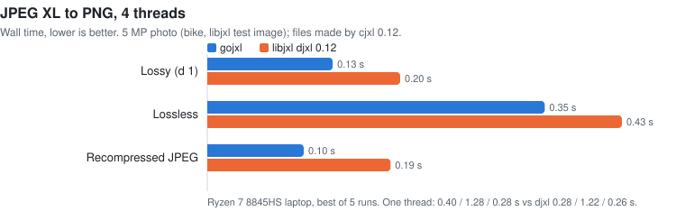
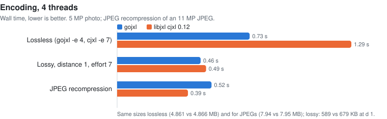

<p align="center">
  
</p>

<h1 align="center">gojxl</h1>

<p align="center">
  <b>Go için JPEG XL: kodlayıcı, kod çözücü ve dönüştürücü; tamamen Go ile.</b><br>
  cgo yok, assembly yok, WASM çalışma zamanı yok. Go'nun derlediği her platform için tek, statik bir dosya.
</p>

<p align="center">
  <a href="https://pkg.go.dev/github.com/bdrtr/gojxl"></a>
  <a href="https://github.com/bdrtr/gojxl/releases"></a>
  <a href="LICENSE"></a>
  
</p>

<p align="center"><a href="README.md">English</a> · <a href="#kurulum">Kurulum</a> · <a href="#karşılaştırma">Karşılaştırma</a> · <a href="#hız-ölçümleri">Hız</a> · <a href="#doğruluk">Doğruluk</a></p>

---

## Öne çıkanlar

- **Aynı kalitede libjxl'den küçük dosyalar.** `cjxl -e 7`'ye karşı, eşit
  [SSIMULACRA 2](https://github.com/cloudinary/ssimulacra2) puanında (BD-rate):
  15 fotoğrafta **%−8,2** (yüksek kalitede %−11), 15 diyagram, ikon ve ekran
  görüntüsünde **%−10,2**. Kayıpsız ve JPEG'den dönüştürülmüş dosyalar 1.983
  dosyalık gerçek dünya derleminde %0,5 daha küçük.
- **Gereken yerde hızlı**: paralel kod çözme ve PNG yazma. 4 çekirdekte JPEG XL'i
  PNG'ye libjxl'in kendi `djxl` aracından hızlı çevirir ([ölçümler](#hız-ölçümleri)).
- **Kayıpsız JPEG yeniden sıkıştırma**: yaklaşık %20 küçük dosya, orijinal JPEG
  **bayt bayt** geri gelir (`cjxl` ile üretilmiş dosyalardan da; bizim
  dosyalarımızı djxl de geri üretir).
- **Yaygın biçimlerin hepsi**: girdi olarak PNG/APNG, GIF, JPEG, WebP (kendi
  çözücümüz, libwebp ile bit düzeyinde aynı), TIFF, BMP ve PGM/PPM/PAM; çıktı
  olarak PNG/APNG, JPEG, PNM ve PFM. Animasyon, alfa, 16-bit, HDR (PQ/HLG) ve ICC
  renk yönetimi dahil.
- **Referansla doğrulanmış**: libjxl conformance seti `djxl`'e 112–216 dB
  yakınlıkta çözülür; kodlayıcının ürettiği her dosya `djxl` ile de çözülür.

## Kurulum

Komut satırı aracı, kaynaktan (Go 1.24 veya üstü):

```sh
go install github.com/bdrtr/gojxl/cmd/gojxl@latest
```

ya da [sürümler](https://github.com/bdrtr/gojxl/releases) sayfasından hazır
dosyayı indirin (Linux, macOS, Windows; amd64 ve arm64).

Kütüphane:

```sh
go get github.com/bdrtr/gojxl
```

## Kullanım

```sh
gojxl encode foto.png foto.jxl            # kayıpsız (renk profili ve Exif/XMP korunur)
gojxl encode -q 90 foto.png foto.jxl      # kayıplı, cjxl tarzı kalite (90 = mesafe 1)
gojxl encode foto.jpg foto.jxl            # kayıpsız JPEG yeniden sıkıştırma
gojxl encode anim.gif anim.jxl            # GIF / APNG / WebP animasyonu -> JXL animasyonu
gojxl decode foto.jxl foto.png            # animasyonlar APNG olur
gojxl decode foto.jxl foto.jpg            # orijinal JPEG, bayt bayt
gojxl encode -q 85 -o cikti/ fotolar/     # klasör ağaçlarının tamamı, paralel
gojxl compare foto.png foto.jxl           # SSIMULACRA 2 ve PSNR
gojxl info foto.jxl
```

```go
import "github.com/bdrtr/gojxl"

img, err := gojxl.Decode(r)                                      // image.Decode'a da kayıtlı
err = gojxl.Encode(w, img, &gojxl.EncodeOptions{Distance: 1})    // kayıplı; Distance 0 = kayıpsız
jxl, err := gojxl.ConvertToJXL(dosya, nil)                       // PNG/GIF/JPEG/WebP/TIFF/BMP/PNM -> JXL
err = gojxl.ConvertToPNG(w, jxl, nil)                            // doğrudan PNG'ye akıtarak
jpg, err := gojxl.ReconstructJPEG(jxl)                           // orijinal JPEG
puan, err := gojxl.SSIMULACRA2(orijinal, bozuk)
```

## Karşılaştırma

| | **gojxl** | [gen2brain/jxl] | [gen2brain/jpegxl] | [kpfaulkner/jxl-go] | [libjxl] |
|---|---|---|---|---|---|
| Yazıldığı dil | **saf Go** | Go + SIMD assembly | WASM'a derlenmiş libjxl (wazero) | saf Go | C++ |
| Kod çözme | ✅ | ✅ | ✅ | kısmi (geliştiriliyor) | ✅ |
| Kayıplı ve kayıpsız kodlama | ✅ | ✅ | ✅ | — | ✅ |
| Kodlarken alfa | ✅ | ✅ | ✅ | — | ✅ |
| Animasyon | kodlama + çözme | çözme | çözme | — | kodlama + çözme |
| Kayıpsız JPEG yeniden sıkıştırma ve bayt bayt geri üretim | ✅ | — | — (yalnız pikseller) | — | ✅ |
| Çıktıda ICC renk yönetimi | ✅ | — | | — | ✅ |
| Girdi biçimleri | PNG, APNG, GIF, JPEG, WebP, TIFF, BMP, PNM | `image.Image` | `image.Image` | — | PNG, APNG, GIF, JPEG, EXR, PNM |
| Komut satırı aracı | ✅ | — | — | — | ✅ |
| Eşit SSIMULACRA 2'de `cjxl -e 7`'ye göre kayıplı boyut | **fotoğraf %−8, grafik %−10** | %+2 … +15 (kendi README'si) | ≈ 0 (libjxl'in kendisi) | — | referans |

Diğer kütüphanelerin satırları kendi belgelerinden alınmıştır (Kasım 2026:
gen2brain/jxl v0.2.1, gen2brain/jpegxl v0.6.0); boş hücreler belgelenmemiştir.
[bench/rivals](bench/rivals) dört Go kütüphanesini aynı dosyalarla ölçer.

[gen2brain/jxl]: https://github.com/gen2brain/jxl
[gen2brain/jpegxl]: https://github.com/gen2brain/jpegxl
[kpfaulkner/jxl-go]: https://github.com/kpfaulkner/jxl-go
[libjxl]: https://github.com/libjxl/libjxl

## Hız ölçümleri

<picture>
  <source media="(prefers-color-scheme: dark)" srcset="docs/decode-dark.svg">
  
</picture>

<picture>
  <source media="(prefers-color-scheme: dark)" srcset="docs/encode-dark.svg">
  
</picture>

| 5 MP fotoğraf, duvar süresi | gojxl, 1 çekirdek | libjxl, 1 çekirdek | gojxl, 4 çekirdek | libjxl, 4 çekirdek |
|---|---|---|---|---|
| Kayıplı dosyayı PNG'ye çözme | 0,40 s | **0,28 s** | **0,13 s** | 0,20 s |
| Kayıpsız dosyayı PNG'ye çözme | 1,28 s | **1,22 s** | **0,35 s** | 0,43 s |
| Yeniden sıkıştırılmış JPEG'i PNG'ye çözme | 0,28 s | **0,26 s** | **0,10 s** | 0,19 s |
| Kayıpsız kodlama (gojxl `-e 4`, cjxl `-e 7`, aynı boyut) | **2,47 s** | 4,66 s | **0,73 s** | 1,29 s |
| Kayıplı kodlama, mesafe 1, efor 7 | 1,48 s | **1,26 s** | **0,46 s** | 0,49 s |
| 11 MP JPEG'i yeniden sıkıştırma (aynı boyut) | 1,30 s | **0,75 s** | 0,52 s | **0,39 s** |

libjxl (`cjxl`/`djxl` 0.12) AVX2 SIMD kullanır; gojxl düz Go'dur ve işin daha
büyük kısmını (PNG yazıcı dahil) paralel yaparak öne geçer. Mesafe 1'de kayıplı
dosyalar 589 KB (SSIMULACRA 2 84,4) ve 679 KB (84,0). Tepe bellek kod çözmede
libjxl'den biraz yüksek (burada yaklaşık 100 MB'a 62 MB), kodlamada düşüktür.
Ryzen 7 8845HS dizüstü, 5 çalıştırmanın en iyisi; diğer Go kütüphanelerini
[bench/rivals](bench/rivals) ölçer.

## Sıkıştırma

Kayıplı, `cjxl -e 7`'ye (libjxl 0.12) karşı eşit puanda BD-rate: negatif değer
aynı kalitede daha küçük dosya demektir. Mesafe 0,25–4; her görüntü iki araçla
kodlanıp aynı ölçütle puanlandı.

| Görüntü seti | SSIMULACRA 2 | SSIMULACRA 2 ≥ 85 (yüksek kalite) | PSNR |
|---|---|---|---|
| 15 fotoğraf (libjxl test görüntüleri, NASA fotoğrafları, duvar kâğıtları) | **%−8,2** | **%−11,1** | **%−16,6** |
| 15 diyagram, ikon ve ekran görüntüsü (bir Linux kurulumundan) | **%−10,2** | **%−4,8** | **%−9,1** |

cjxl'in önde kaldığı tek fotoğraf yoğun dokulu bir sahne (%+2…3). Metin
benzeri ekran görüntülerinde patch'ler (harfler bir referans karesinde bir kez
saklanır) kullanılır, saydam alanlar libjxl'in yöntemiyle sadeleştirilir,
luma'dan kroma tahmini her 64×64 karo için artıkların maliyetine göre seçilir.

Kayıpsız, varsayılan eforlar (gojxl `-e 4`, cjxl `-e 7`): 1.983 PNG, GIF ve JPEG
dosyasında (JPEG'ler yeniden sıkıştırılarak) 149,5 MB'a karşı 150,2 MB; 5 MP bir
fotoğraf aynı boyutta 1,8× daha hızlı kodlanır. `-e 5` daha da küçüktür.

## Doğruluk

- **Conformance**: resmi
  [JPEG XL conformance](https://github.com/libjxl/conformance) setinin bütün
  dosyaları çözülür; 16-bit çıktı `djxl`'e 112–216 dB PSNR yakınlıktadır
  (kayıpsız dosyalar bit düzeyinde aynı). İstisnalar: `djxl`'in doğrusal sRGB
  yazdığı dosyalar (ICC etiketli XYB; gojxl orijinal renk uzayını korur) ve
  iki aracın farklı renk motorları kullandığı CMYK.
- **Gerçek dünya derlemi**: bir Linux kurulumunda bulunan 1.983 görüntü
  (belge görselleri, ikonlar, ekran görüntüleri, fotoğraflar). Her kayıpsız
  dosya `djxl`'de kaynak piksellere çözülür, 130 JPEG'in hepsi bayt bayt geri
  üretilir, kayıplı dosyaları `djxl` ve gojxl aynı piksellere çözer (1/65535
  içinde).
- **Fuzzing**: JXL çözücü ile PNG, JPEG, WebP, TIFF ve PNM okuyucuları için fuzz
  hedefleri var; bulunan askılar, dev bellek ayırmaları ve karesel yavaşlıklar
  düzeltildi ve gerileme girdisi olarak saklanıyor.

## Durum

Hareketsiz görüntüler ve animasyonlar için özellikleri tamam. Bilinen
eksikler: 1–4 eforlarında kayıplı kodlama `cjxl -e 1…4`'ten yavaş (tek
çekirdekte yaklaşık 2×), tek çekirdekte PNG'ye çözme AVX2 kullanan `djxl`'in
1,05–1,4 katı sürüyor (gojxl düz Go), gri görüntüler kayıplı ya da alfalı kodlanırken
renkli saklanıyor (gerekenden büyük, ama doğru). İsteğe bağlı SIMD çekirdekleri
(yine saf Go) `GOEXPERIMENT=simd` ile derlenir. Ayrıntılı notlar:
[docs/DETAILS.tr.md](docs/DETAILS.tr.md).

## Lisans

BSD 3-Clause, bkz. [LICENSE](LICENSE). Büyük bölümler
[libjxl](https://github.com/libjxl/libjxl)'i (BSD 3-Clause) izler ya da port
eder; bkz. [THIRD_PARTY_NOTICES.md](THIRD_PARTY_NOTICES.md). libjxl'in patent
izni yalnız libjxl'i kapsar, başka uygulamalara hak vermez.
